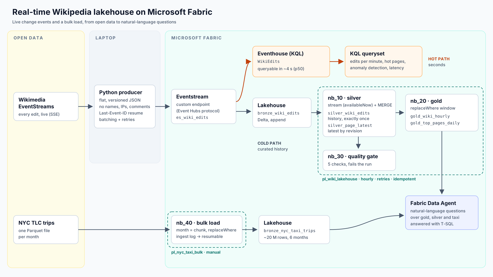

# Real-time Wikipedia Lakehouse on Microsoft Fabric

A streaming + batch data platform on **Microsoft Fabric**, built only on open data:

* **Live:** every edit on Wikipedia (Wikimedia EventStreams) → **Eventstream** → **Lakehouse**
  (bronze → silver → gold, Delta) and **Eventhouse** (KQL, seconds of latency)
* **Bulk:** NYC TLC taxi trips, hundreds of millions of rows, loaded month by month
* **Orchestration:** Data Pipelines with schedule, retries and quality gates
* **AI:** a **Fabric Data Agent** that answers natural-language questions from the gold tables



```
 Wikimedia EventStreams (SSE)                                                         ┌─► Eventhouse  WikiEdits ──► KQL / Real-Time Dashboard
          │                                                                           │
   producer (Python) ── flat JSON, no personal data ──► Eventstream (custom endpoint) ─┤
          resume via Last-Event-ID, batching, retries        Event Hubs protocol      └─► Lakehouse  bronze_wiki_edits
                                                                                                 │  nb_10  Structured Streaming (availableNow) + MERGE
                                                                                                 ▼
                                                                    silver_wiki_edits (history)   silver_page_latest (latest state)
                                                                                                 │  nb_20  replaceWhere window
                                                                                                 ▼
                                                                          gold_wiki_hourly   gold_top_pages_daily ──► Data Agent / Power BI
                                                                                                 │  nb_30  quality gate
 NYC TLC monthly Parquet ── nb_40 (month = chunk, replaceWhere, ingest log) ──► bronze_nyc_taxi_trips
```

| Part | Where |
|---|---|
| Producer: Wikimedia → Eventstream | `producer/wiki_producer/` |
| Spark library (wheel for a Fabric Environment) | `fabric/lib/src/wikilake/` |
| Notebooks | `fabric/notebooks/` |
| Eventhouse KQL | `fabric/eventhouse/wiki_realtime.kql` |
| Pipelines | `fabric/pipeline/README.md` |
| Data Agent instructions + example queries | `fabric/data_agent/agent_instructions.md` |
| Tests (local PySpark) | `tests/` |

---

## Open-source stack vs. Fabric

| Concern | Typical OSS stack | Here (Fabric) |
|---|---|---|
| Event transport | Kafka | Eventstream (Event Hubs / Kafka-compatible endpoint) |
| Real-time store | Druid / ClickHouse | Eventhouse (KQL) |
| Lake storage | Parquet on S3 + Hive / Iceberg | OneLake + Delta (Lakehouse) |
| Processing | Spark on YARN / K8s | Fabric Spark notebooks + Environment |
| Orchestration | Airflow | Data Pipelines |
| SQL serving | Trino / Presto | Lakehouse SQL analytics endpoint |
| Natural-language analytics | custom LLM + SQL tool | Fabric Data Agent |

---

## Setup

### Prerequisites
* A Fabric workspace on a Fabric capacity or trial
* Python 3.10+ on your machine for the producer

### 1. Lakehouse and Environment
1. Create a Lakehouse **`wiki_lakehouse`**.
2. Build the library wheel: `cd fabric/lib && pip install build && python -m build --wheel`
3. Create an **Environment** `env_wikilake`, upload `dist/wikilake-1.0.0-py3-none-any.whl` under
   *Custom libraries*, **Publish**.

### 2. Eventstream
1. Create Eventstream **`es_wiki_edits`** → *Add source* → **Custom endpoint**.
2. Add destination **Lakehouse** → `wiki_lakehouse`, table **`bronze_wiki_edits`**, input format JSON.
3. Add destination **Eventhouse** (create a KQL database `wiki_rt`), table **`WikiEdits`**, JSON.
4. Publish. Open the custom endpoint → *Event Hub* → *SAS Key Authentication* → copy
   **Connection string-primary key**.

No transformation is needed: the producer already sends flat, type-stable records, which
is what the Lakehouse destination requires.

### 3. Run the producer
```bash
cd producer
python -m venv .venv && source .venv/bin/activate && pip install -r requirements.txt
cp ../.env.example ../.env    # fill in, then: set -a; source ../.env; set +a
python -m wiki_producer.main --wikis enwiki,dewiki,trwiki --duration 3600
```
Dry run without Fabric: `python -m wiki_producer.main --sink jsonl --output sample.jsonl --max-events 200`.

### 4. Notebooks
Import the four notebooks from `fabric/notebooks/` (*Import → Notebook*), attach
`wiki_lakehouse` as default Lakehouse and `env_wikilake` as Environment. Run `nb_10` once to
create the silver tables.

### 5. Pipelines, Eventhouse, Data Agent
* Pipelines: follow `fabric/pipeline/README.md` (hourly `pl_wiki_lakehouse`, manual `pl_nyc_taxi_bulk`).
* Eventhouse: open a KQL Queryset on `wiki_rt` and run `fabric/eventhouse/wiki_realtime.kql`.
* Data Agent: *New item → Data agent*, add `wiki_lakehouse`, paste the instructions and example
  queries from `fabric/data_agent/agent_instructions.md`.

---

## Design decisions

**Flat, versioned event contract at the producer.** The Lakehouse destination enforces a Delta
schema and fails on nested or type-switching JSON. Flattening once at the edge keeps
Eventstream simple and makes the contract explicit (`schema_version`).

**Privacy by design.** Logged-out Wikipedia edits are attributed to a temporary account
(`~2025-01234-56`) or, on wikis without temporary accounts, an IP address; edit comments are
free text. The producer keeps none of these: only `user_type` (bot / anonymous / registered,
where anonymous = logged out) and `comment_length`.

**At-least-once delivery, exactly-once tables.** Retries and reconnects can deliver an event
twice. Silver de-duplicates within each micro-batch and MERGEs on `event_id`, so the history
table has each edit exactly once.

**History vs. latest state.** `silver_wiki_edits` keeps every edit; `silver_page_latest` holds one
row per page. The latest state is ordered by `revision_new` (monotonic per page), not by
arrival time, so a late event never overwrites a newer revision.

**Streaming that also runs on a schedule.** `trigger(availableNow=True)` processes everything
new since the checkpoint and stops, which suits an hourly pipeline. Switching to a continuous
trigger is a parameter.

**Idempotent batch.** Gold recomputes a sliding window with `replaceWhere`; the taxi load
writes each month with `replaceWhere pickup_month = ...` and records it in an ingest log. Any
step can be retried or re-run without duplicates.

**Bulk load in bounded chunks.** One month = one file = one transaction. Memory stays bounded,
a failure costs one month, and a re-run resumes. Each file is cast to one canonical schema,
because TLC column names and types changed over the years.

**Hot and cold paths from one stream.** Eventhouse answers "what is happening now" within
seconds; the Lakehouse holds curated history for BI and the Data Agent.

---

## Testing

```bash
pip install -r requirements-dev.txt
pytest -q
```
The tests run the producer against a recorded SSE stream (including a dropped connection and
resume, a malformed event, and the privacy rules), then feed its output through the silver,
gold and quality logic on local PySpark, and check the taxi schema normalization across
format eras. Delta-specific statements (MERGE, `replaceWhere`) run on the Fabric runtime.

## Lessons from running it

Things that only showed up on a real workspace with live data:

* **Wire the Eventstream destinations.** Adding a destination does not connect it. Drag a connection from the stream node to each destination, then **Publish**.
* **Check the canvas after a break.** After two idle weeks both destinations were *Inactive* while the source was still *Active*, so events were accepted and went nowhere. When you reactivate, start from a custom time before your producer started, not *Now*, or the buffered events are skipped.
* **Quote values in `.env`.** The user agent contains parentheses and the connection string contains semicolons; zsh needs double quotes around both.
* **Run the producer before the first notebook.** `bronze_wiki_edits` only exists after the Lakehouse destination receives its first events.
* **Expect slow Spark session starts with a custom library.** With the `wikilake` wheel in the Environment, a session took several minutes to start, once per notebook activity. Enable *Workspace settings → Data Engineering/Science → Spark settings → High concurrency → For pipeline running multiple notebooks* so the three notebooks in `pl_wiki_lakehouse` share one session.
* **Refresh the Data Agent after recreating tables.** Dropped and recreated tables are new objects; refresh the agent's data source and re-check the table selections.
* **Read latency over a steady window.** During a catch-up after reactivation, p95 latency looks terrible because it measures backlog. In steady streaming the measured p50 was 4 s and p95 11 s.
* **Logged-out editors are temporary accounts.** Wikipedia now shows logged-out edits as `~2025-…` names instead of IP addresses; the producer counts both as `anonymous`.

## Known limitations / next steps
* The silver MERGE and gold windows are tested for logic locally; an integration test on a
  Fabric workspace (via the Fabric REST API in CI) would cover the Delta I/O.
* Pipelines are described, not exported; Fabric Git integration could version them.
* No Power BI report is included yet (Direct Lake on the gold tables is the natural next step).
* The producer runs on a laptop; for 24/7 operation it would run as a container (e.g. Azure
  Container Apps) with a managed identity.

## Data sources and licenses
* Wikimedia EventStreams: https://stream.wikimedia.org (send a descriptive `User-Agent`; page
  titles and metadata only, no article content)
* NYC TLC Trip Record Data: https://www.nyc.gov/site/tlc/about/tlc-trip-record-data.page
